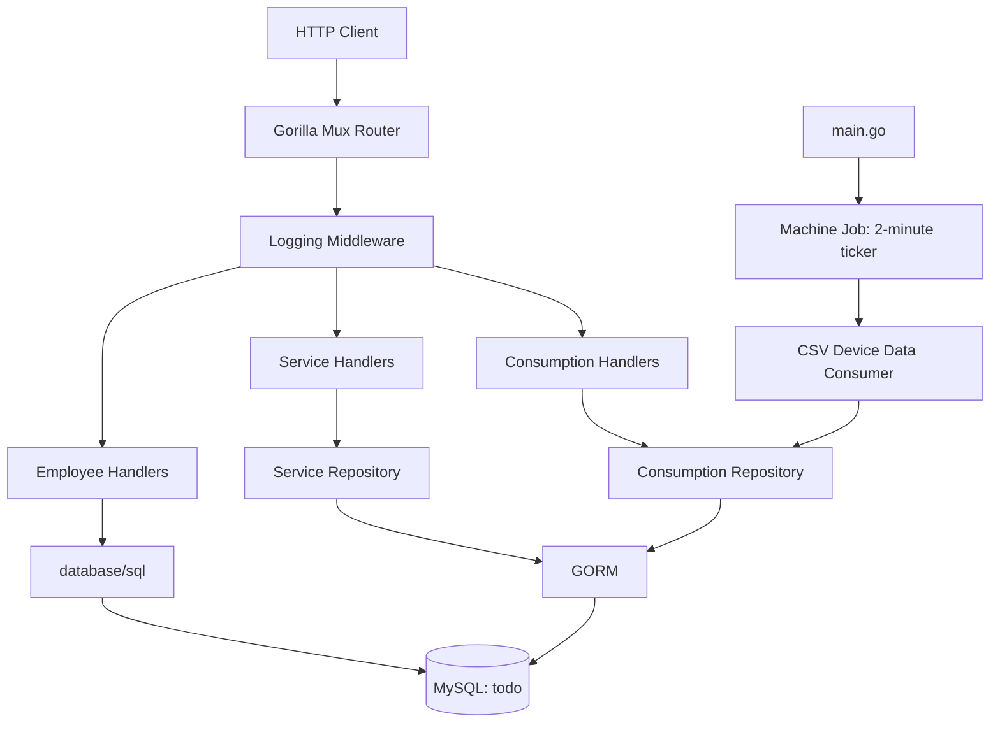
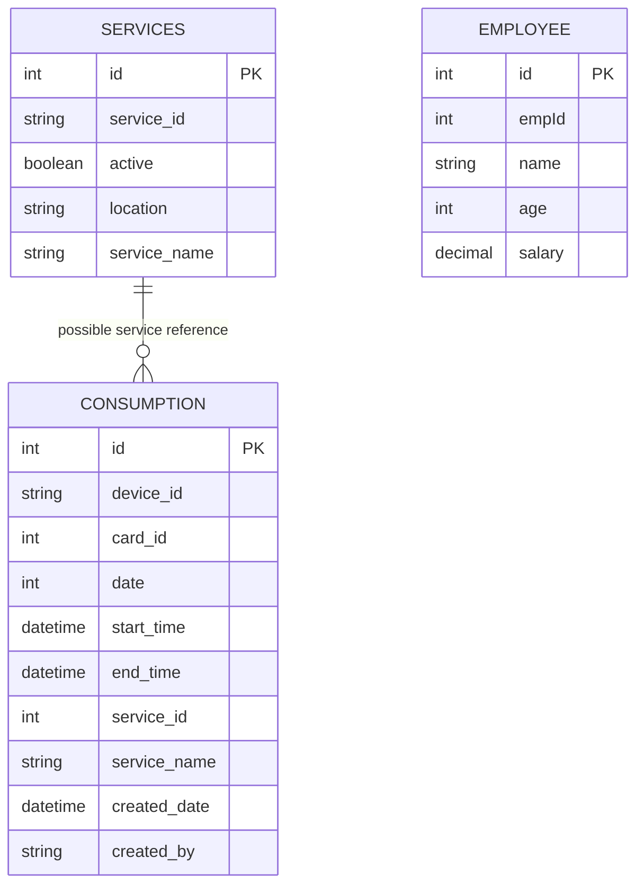

# BubblePays — Technical Project Documentation

> **Repository:** `alekhyarani2812/bubblepays`  
> **Go module:** `github.com/bubblepays`  
> **Go version declared:** `1.22.1`  
> **Database:** MySQL  
> **Documentation basis:** Source code in the supplied `bubblepays-master.zip` archive.

---

## 1. Project overview

BubblePays is a Go HTTP backend backed by a MySQL database. The codebase exposes REST-style endpoints for employee, service, and consumption records. It also contains a background process intended to ingest device-consumption data from CSV files and persist those records to the database.

The application is currently best described as a small backend/service prototype or starter application. The source includes working CRUD paths for several resources, but some endpoints and supporting areas are unfinished. In particular, service deletion is a stub, the employee API uses direct SQL while the service and consumption APIs use GORM, and the database schema and deployment configuration are not included in the archive.

### 1.1 Main capabilities found in the source

| Capability | Implementation status |
|---|---|
| HTTP server on port 8080 | Implemented |
| Request middleware | Implemented; currently prints a message |
| Employee list/create/update/delete | Implemented using `database/sql` |
| Service list/create | Implemented using GORM |
| Service delete | Route exists; handler/repository are incomplete |
| Consumption list/get-by-ID/create/delete | Implemented using GORM |
| CSV device-consumption ingestion | Implemented, subject to fixed filesystem path and input format |
| Periodic ingestion trigger | Implemented with a two-minute ticker |
| Unit tests | Present, but current tests provide very limited behavioral coverage |
| Jenkins build/test pipeline | Present |

The repository does not establish a payment-processing, wallet, card-charging, or payment-gateway workflow. Although the repository is named BubblePays, this documentation does not assume such functionality exists.

---

## 2. Technology stack

| Technology | Version / usage |
|---|---|
| Go | `1.22.1` declared in `go.mod` |
| Gorilla Mux | `v1.8.1` — HTTP routing and path variables |
| GORM | `v1.25.9` — ORM for service and consumption persistence |
| GORM MySQL driver | `v1.5.6` |
| MySQL driver | `github.com/go-sql-driver/mysql v1.8.1` |
| Testify | `v1.9.0` — assertions in tests |
| MySQL | Database configured as `todo` on local port `3306` |
| Jenkins | Pipeline for checkout, build, test, and JUnit report publication |

### 2.1 Important architectural observation

Two persistence approaches coexist:

1. **Employee APIs:** use `database/sql` and handwritten SQL statements.
2. **Service and Consumption APIs:** use GORM through `database.GetORMDbConnection()`.

This is functional but creates two different data-access conventions. A future cleanup could standardize on one approach.

---

## 3. High-level architecture

The code follows a layered structure:

- **HTTP/router layer:** registers routes and applies middleware.
- **Handler layer:** decodes HTTP input, invokes repository functions, and writes JSON responses.
- **Repository layer:** performs database operations.
- **Model layer:** defines Go structs representing API/database records.
- **Database layer:** creates MySQL connections.
- **Jobs layer:** runs periodic background work.
- **Utils layer:** provides response rendering and conversion helpers.

### 3.1 Component diagram



### 3.2 Request lifecycle

For an HTTP request:

1. The client sends a request to port `8080`.
2. The request enters the Gorilla Mux router.
3. The registered middleware logs `Middleware executing`.
4. Gorilla Mux selects the handler based on the path and HTTP method.
5. The handler validates/parses path parameters or decodes JSON.
6. The handler calls the corresponding repository or database function.
7. The data layer accesses MySQL.
8. The handler builds a `models.Response`.
9. `utils.Render` sets the JSON content type, writes the HTTP status, and encodes the response.

---

## 4. Repository structure

```text
bubblepays/
├── api/
│   └── handler/
│       ├── consumption/
│       │   └── consumption.go
│       ├── employee/
│       │   ├── delete_handler.go
│       │   ├── hellowold_message_handler.go
│       │   ├── insert_handler.go
│       │   ├── read_handler.go
│       │   └── update_handler.go
│       └── service/
│           └── service.go
├── context/
│   └── context.go
├── database/
│   └── db.go
├── docs/
│   ├── golang-books.md
│   └── golang-interview-questions.md
├── jobs/
│   ├── machine_jobs.go
│   ├── usage_job.go
│   └── usage_job_test.go
├── models/
│   ├── consumption_model.go
│   ├── employee_model.go
│   ├── service_model.go
│   └── utils_model.go
├── repository/
│   ├── consumption/
│   │   ├── consumption.go
│   │   └── consumptionRepo.go
│   └── service/
│       └── service.go
├── utils/
│   ├── constant.go
│   ├── utils.go
│   └── utils_test.go
├── .gitignore
├── Jenkinsfile
├── Makefile
├── README.md
├── go.mod
└── go.sum
```

### 4.1 Directory responsibilities

| Directory / file | Responsibility |
|---|---|
| `main.go` | Application entry point, route registration, middleware, background-job startup, HTTP listener |
| `api/handler/employee` | Employee HTTP endpoints |
| `api/handler/service` | Service HTTP endpoints |
| `api/handler/consumption` | Consumption HTTP endpoints |
| `repository/service` | GORM-based service data access |
| `repository/consumption` | GORM-based consumption data access and CSV ingestion |
| `models` | Request, response, and persistence structs |
| `database` | MySQL connection creation |
| `jobs` | Periodic machine-data processing |
| `utils` | JSON response helper and string/time conversion |
| `context` | Experimental request-context helper; not wired into the router |
| `docs` | Go learning/interview reference material |
| `Jenkinsfile` | Jenkins CI pipeline |
| `Makefile` | Build, dependency-vendor, and test targets |

---

## 5. Application startup and routing

The entry point is `main.go`.

### 5.1 Startup sequence

1. Prints `This is main package`.
2. Starts `jobs.RunMachineJob()` in a goroutine.
3. Creates a Gorilla Mux router.
4. Registers the `middleware` function with `router.Use`.
5. Registers the HTTP endpoints.
6. Mounts the router at the default HTTP mux path `/`.
7. Starts `http.ListenAndServe(":8080", nil)`.

The machine job runs concurrently with the HTTP server. The call to `ListenAndServe` blocks while the server is running.

### 5.2 Middleware

The middleware currently logs a message and passes the request to the next handler:

```go
func middleware(next http.Handler) http.Handler {
    return http.HandlerFunc(func(w http.ResponseWriter, r *http.Request) {
        fmt.Println("Middleware executing")
        next.ServeHTTP(w, r)
    })
}
```

It does not currently implement authentication, authorization, request IDs, structured logging, CORS, or panic recovery.

### 5.3 Route catalogue

| Method | Path | Handler | Purpose |
|---|---|---|---|
| GET | `/api/hello` | Inline handler in `main.go` | Returns plain-text `Hello` |
| GET | `/api/getservices` | `service.GetServices` | List services |
| POST | `/api/saveservice` | `service.SaveService` | Create a service |
| DELETE | `/api/deleteservice/{id}` | `service.DeleteServiceById` | Registered, but handler is currently empty |
| GET | `/api/consumptions` | `consumption.GetConsumptions` | List consumption records |
| GET | `/api/consumptions/{id}` | `consumption.GetConsumptionById` | Fetch a consumption record by primary key |
| POST | `/api/saveconsumption` | `consumption.SavesConsumption` | Create a consumption record |
| DELETE | `/api/deleteconsumption/{id}` | `consumption.DeleteConsumption` | Delete a consumption record |
| GET | `/api/employees` | `employee.GetEmployeesJsonData` | List employees |
| POST | `/api/employee` | `employee.SaveEmployee` | Create an employee |
| DELETE | `/api/deleteEmployee/{id}` | `employee.DeleteEmpHandler` | Delete an employee |
| PUT | `/api/updateEmployee/{id}` | `employee.UpdateEmpHandler` | Update an employee |

**Note:** `GetMessageHandler` exists in `hellowold_message_handler.go`, but its route is commented out in `main.go`. It is therefore not currently reachable through the router.

---

## 6. API conventions

Most API handlers return a JSON object using the common `models.Response` structure:

```json
{
  "message": "success",
  "description": "Optional human-readable description",
  "error": "",
  "status": 200,
  "data": {}
}
```

Fields:

| Field | Type | Meaning |
|---|---|---|
| `message` | string | Usually `success` or `fail` |
| `description` | string | Human-readable operation result |
| `error` | string | Error details when present |
| `status` | integer | HTTP status code also written to the response |
| `data` | any | Result payload |

The constants `utils.Success` and `utils.Fail` provide the message values.

### 6.1 Response helper

`utils.Render(w, response)`:

1. Sets `Content-Type: application/json`.
2. Writes `response.Status` as the HTTP status.
3. Encodes the response as JSON.

A potential issue is that `Render` calls `log.Fatal` if JSON encoding fails. `log.Fatal` terminates the entire process. A handler should not normally terminate the server because one response could not be encoded; this should be changed to ordinary error logging and a safe response strategy.

---

## 7. Employee module

Employee persistence is implemented with `database/sql` and handwritten SQL.

### 7.1 Employee model

Defined in `models/employee_model.go`:

```go
type Employee struct {
    Id     int     `json:"id"`
    EmpId  int     `json:"empId"`
    Name   string  `json:"name"`
    Salary float64 `json:"salary"`
    Age    int     `json:"age"`
}
```

The SQL code assumes an `employee` table with columns in this scan order:

```text
id, empId, name, age, salary
```

This is inferred from the `SELECT *` scans and insert/update statements. The actual DDL is not included in the supplied archive, so column types, keys, constraints, and indexes cannot be confirmed.

### 7.2 List employees — `GET /api/employees`

Handler: `GetEmployeesJsonData`  
Data function: `GetEmployees`

The handler:

1. Opens a MySQL connection using `database.GetDbConnection()`.
2. Executes `SELECT * FROM employee`.
3. Scans each row into an `Employee`.
4. Returns the employee slice in the common response envelope.

Example response shape:

```json
{
  "message": "success",
  "status": 200,
  "data": [
    {
      "id": 1,
      "empId": 1001,
      "name": "Example Employee",
      "salary": 50000,
      "age": 30
    }
  ]
}
```

The example values are illustrative, not repository data.

### 7.3 Create employee — `POST /api/employee`

Handler: `SaveEmployee`

Expected JSON:

```json
{
  "empId": 1001,
  "name": "Example Employee",
  "age": 30,
  "salary": 50000
}
```

Processing:

1. Opens a database connection.
2. Decodes the request JSON into `models.Employee`.
3. Executes a parameterized `INSERT INTO employee (empId, name, age, salary) VALUES (?,?,?,?)`.
4. Queries the inserted employee by `empId`.
5. Returns HTTP `201 Created` with the inserted record.

The helper `getEmployeeByEmployeeID` uses `SELECT * FROM employee WHERE empId = ?`.

### 7.4 Update employee — `PUT /api/updateEmployee/{id}`

Handler: `UpdateEmpHandler`

Path parameter:
- `id`: employee table primary key.

Expected JSON:

```json
{
  "empId": 1001,
  "name": "Updated Employee",
  "age": 31,
  "salary": 55000
}
```

Processing:

1. Reads `{id}` from Gorilla Mux.
2. Converts it to an integer with `utils.StringToInt`.
3. Decodes the JSON request body.
4. Executes an `UPDATE employee SET empId=?, name=?, age=?, salary=? WHERE id=?`.
5. Checks `RowsAffected`.
6. Fetches the updated row using `getEmployeeByID`.
7. Returns HTTP `200` if rows were affected; otherwise returns a failure response.

### 7.5 Delete employee — `DELETE /api/deleteEmployee/{id}`

Handler: `DeleteEmpHandler`

Processing:

1. Reads and converts the primary-key path parameter.
2. Executes `DELETE FROM employee WHERE id=?`.
3. Checks the affected-row count.
4. Returns success if a row was deleted, otherwise returns a failure response.

### 7.6 Employee implementation notes

- SQL statements use placeholders for input values, which is preferable to concatenating user input into SQL.
- `SELECT *` makes the scan dependent on the exact database column order. Explicit column lists are safer.
- `GetEmployees` writes an error response if the query fails but does not return immediately. It should stop processing after the failure.
- Several row iterators should check `rows.Err()` and close `rows`.
- `getEmployeeByEmployeeID` does not currently check `rows.Err()` or close its result set.
- Employee endpoints do not share the GORM repository abstraction used by other modules.

---

## 8. Service module

Service HTTP handlers are in `api/handler/service/service.go`; database operations are in `repository/service/service.go`.

### 8.1 Service model

```go
type Services struct {
    Id          int    `json:"id"`
    ServiceId   string `json:"service_id"`
    Active      bool   `json:"active"`
    Location    string `json:"location"`
    ServiceName string `json:"service_name"`
}

func (Services) TableName() string {
    return "services"
}
```

The explicit GORM table name is `services`.

### 8.2 List services — `GET /api/getservices`

Processing:

1. Handler calls `service.GetServices()`.
2. Repository obtains a GORM connection.
3. GORM runs `Find(&service)`.
4. Handler returns the resulting slice with HTTP `200`.

### 8.3 Create service — `POST /api/saveservice`

Expected JSON shape:

```json
{
  "service_id": "SVC-100",
  "active": true,
  "location": "Example Location",
  "service_name": "Example Service"
}
```

Processing:

1. Handler decodes JSON into `models.Services`.
2. Calls `repository/service.SaveService`.
3. Repository calls `dbConnection.Create(&service)`.
4. Handler returns HTTP `201 Created` with the created model.

### 8.4 Delete service — `DELETE /api/deleteservice/{id}`

The route is registered, but `DeleteServiceById` in the HTTP handler is empty. The repository function `DeleteServiceById()` is also only a logging stub and accepts no ID.

**This endpoint is not implemented yet.** A complete implementation needs to parse the ID, call a repository delete method, inspect errors and affected rows, and return a suitable response.

### 8.5 Service database assumptions

The model and repository imply a `services` table with fields corresponding to `id`, `service_id`, `active`, `location`, and `service_name`. The exact SQL schema is not present in the archive.

---

## 9. Consumption module

Consumption has both HTTP CRUD operations and a file-ingestion workflow.

### 9.1 Consumption model

Defined in `models/consumption_model.go`:

```go
type Consumption struct {
    Id          int        `json:"id"`
    DeviceId    string     `json:"device_id"`
    CardId      int        `json:"card_id"`
    Date        int        `json:"date"`
    StartTime   *time.Time `json:"start_time"`
    EndTime     *time.Time `json:"end_time"`
    ServiceId   int        `json:"service_id"`
    ServiceName string     `json:"service_name"`
    CreatedDate *time.Time `json:"created_date"`
    CreatedBy   string     `json:"created_by"`
}

func (Consumption) TableName() string {
    return "consumption"
}
```

The GORM table name is explicitly set to `consumption`.

### 9.2 List consumptions — `GET /api/consumptions`

Repository function: `GetConsumptions`

- Opens a GORM connection.
- Executes `Find(&consumption)`.
- Returns all records found.
- Handler returns the records in the standard JSON response.

No pagination or filtering is implemented.

### 9.3 Get one consumption — `GET /api/consumptions/{id}`

Repository function: `GetConsumptionById`

- Handler reads `{id}` using `mux.Vars`.
- `utils.StringToInt` validates/converts the ID.
- Repository executes `Where("id = ?", id).First(&consumption)`.
- Handler returns the record.

The repository signature returns a slice even though `First` loads a single record. A single-record return type would be clearer.

### 9.4 Create consumption — `POST /api/saveconsumption`

Expected JSON shape:

```json
{
  "device_id": "DEVICE-01",
  "card_id": 123,
  "date": 20261031,
  "start_time": "2026-10-31T09:00:00Z",
  "end_time": "2026-10-31T10:00:00Z",
  "service_id": 10,
  "service_name": "Example Service",
  "created_by": "system"
}
```

The example is illustrative. The timestamp format accepted by Go's JSON decoder for `time.Time` should be RFC3339-compatible. The CSV ingestion parser uses a different format, described below.

Processing:

1. Handler decodes the request into `models.Consumption`.
2. Calls `repository/consumption.SavesConsumption`.
3. Repository opens a GORM connection and calls `Create`.
4. Handler returns HTTP `200 OK` with a success description.

A create operation would conventionally return `201 Created`, as the service create handler already does.

### 9.5 Delete consumption — `DELETE /api/deleteconsumption/{id}`

Repository function: `DeleteConsumption`

- Converts the ID to an integer.
- GORM deletes rows matching `id`.
- Repository returns `RowsAffected`.
- Handler returns success if a row was affected; otherwise it returns a failure response.

A database error is logged in the repository, but the current code does not return that error from the delete result path. It should return `result.Error` when present.

---

## 10. Device-consumption CSV ingestion

The file-ingestion implementation is in `repository/consumption/consumptionRepo.go`.

### 10.1 Input directory

The consumer reads files from this hard-coded path:

```text
/home/satyanarayana/Alekhya/gofilesdirectories/start_consume/
```

This directory must exist and be readable by the process. The path is specific to the development environment and should be externalized into configuration before deployment.

### 10.2 CSV layout

The consumer accesses each record by numeric index:

| CSV index | Expected value | Conversion / destination |
|---:|---|---|
| 0 | Device ID | `Consumption.DeviceId` |
| 1 | Card ID | Converted to integer → `CardId` |
| 2 | Date | Converted to integer → `Date` |
| 3 | Start timestamp | Parsed → `StartTime` |
| 4 | End timestamp | Parsed → `EndTime` |
| 5 | Service ID | Converted to integer → `ServiceId` |
| 6 | Service name | `ServiceName` |

The code expects at least seven columns per row. It does not validate the header or check record length before indexing. A malformed/short row can therefore cause a panic.

### 10.3 Timestamp format

`utils.StringToTime` uses this layout:

```text
2006-01-02 15:04:05
```

Example:

```text
2026-10-31 09:30:00
```

This is a Go reference-time layout, not a general-purpose format string.

### 10.4 Processing sequence

`ConsumeDeviceData()`:

1. Opens the configured input directory.
2. Reads directory entries.
3. For each entry, reads the file as CSV using `csv.Reader.ReadAll`.
4. Converts the expected CSV fields into a `models.Consumption`.
5. Sets `CreatedDate` to the current time.
6. Sets `CreatedBy` to the hard-coded value `Alekhya`.
7. Starts one goroutine per valid CSV record to call `SaveFileConsumption`.
8. Waits for all launched goroutines.
9. Deletes every file in the directory that was listed at the start of the run.

### 10.5 Concurrency and reliability considerations

The current implementation has important data-loss and operational risks:

- Files are deleted after the wait group completes even if one or more database inserts failed. Failed records can therefore be lost.
- The file is not moved to a processing/archive/error directory before it is read.
- A process crash during processing can leave files in an ambiguous state.
- Multiple job invocations could attempt to process the same files if the consumer is ever called concurrently.
- A new database connection is opened for every record.
- There is no concurrency limit; a large CSV can launch a large number of goroutines.
- CSV rows are not validated for length before indexing.
- The code does not distinguish directories from regular files.
- `SaveFileConsumption` calls `wg.Done()` only after obtaining a DB connection. If connection creation fails, the function returns without decrementing the wait group, so `wg.Wait()` can block indefinitely.
- `SaveFileConsumption` does not use its `createdBy` local value to populate the record; the caller sets `CreatedBy`.
- `ReadConsumptionData` returns `nil` on file/read errors, but the caller cannot distinguish an empty file from a read failure.

**Recommended safer workflow:** atomically move a file into a `processing` directory, validate its rows, insert within a transaction or controlled batch, and only move it to `processed` after confirmed success. On failure, move it to `failed` and retain an error log. Use a bounded worker pool and ensure every goroutine calls `Done` with `defer`.

### 10.6 `PickDeviceData()`

This helper moves files from:

```text
/home/satyanarayana/Alekhya/machine_data
```

to:

```text
/home/satyanarayana/Alekhya/start_consume
```

It uses `filepath.Glob` and `os.Rename`. It is not called by `RunMachineJob` in the current source. The source and destination paths are also hard-coded.

---

## 11. Background jobs

`main.go` starts the machine job using:

```go
go jobs.RunMachineJob()
```

`RunMachineJob()` creates a ticker with a two-minute interval:

```go
ticker := time.NewTicker(2 * time.Minute)
```

On each tick it logs a message and calls:

```go
consumption.ConsumeDeviceData()
```

The log message says “every 10 seconds,” but the actual ticker interval is **two minutes**. The code comment/log should be corrected.

The job has no context cancellation or graceful shutdown mechanism. It also does not run the ingestion function immediately at startup; it waits for the first ticker event.

`jobs/usage_job.go` contains an unexported empty `usage()` function and does not currently contribute behavior.

---

## 12. Database configuration and data model

### 12.1 Connection settings found in source

Both database functions connect to a local MySQL instance and database named `todo`.

`GetDbConnection()` DSN:

```text
root:root@tcp(localhost:3306)/todo
```

`GetORMDbConnection()` DSN:

```text
root:root@tcp(127.0.0.1:3306)/todo?charset=utf8mb4&parseTime=True&loc=Local
```

These settings are hard-coded in `database/db.go`.

### 12.2 Tables implied by the source

| Table | Used by | Fields inferred from code |
|---|---|---|
| `employee` | Employee handlers | `id`, `empId`, `name`, `age`, `salary` |
| `services` | Service repository | `id`, `service_id`, `active`, `location`, `service_name` |
| `consumption` | Consumption repository | `id`, `device_id`, `card_id`, `date`, `start_time`, `end_time`, `service_id`, `service_name`, `created_date`, `created_by` |

These are code-level assumptions, not verified database DDL. No migration files or `CREATE TABLE` scripts were included in the archive.

### 12.3 Conceptual relationship diagram

The code contains `service_id` in both service and consumption models, suggesting a possible relationship. However, the repository does not declare or preload a GORM association, and the database foreign key is not supplied. The following is therefore a conceptual model only:



There is no evidenced relationship between `employee` and the other tables in the Go source.

### 12.4 Database connection recommendations

- Move credentials and host/database settings into environment variables or a secret manager.
- Avoid committing real credentials.
- Configure connection pooling for `database/sql` and reuse a long-lived DB handle.
- Avoid opening a new GORM connection for every repository operation.
- Add schema migrations and version them with the application.
- Add indexes for primary keys and frequently queried fields.
- Use explicit table/column definitions and verify types against the real schema.

---

## 13. Utilities and shared models

### 13.1 `utils.StringToInt`

- Rejects an empty string.
- Uses `strconv.Atoi`.
- Returns an error that includes the invalid input if conversion fails.

Used for path IDs and numeric CSV fields.

### 13.2 `utils.StringToTime`

- Parses a timestamp using `2006-01-02 15:04:05`.
- Returns a pointer to `time.Time`.
- Returns the parsing error when the value does not match the expected layout.

### 13.3 `utils.Render`

Centralizes JSON response headers, HTTP status, and response encoding. See the response-helper section for the `log.Fatal` concern.

### 13.4 Context helper

`context/context.go` defines `ContextMiddleware`, which reads and logs `r.Context()`. It is not registered in `main.go`. It also calls `context.Background()` without using the returned context. This package currently has no effect on application request handling.

---

## 14. Configuration

The archive does not contain a centralized configuration package or environment-based configuration.

Values that should be configurable include:

| Setting | Current value / location |
|---|---|
| HTTP port | `8080` in `main.go` |
| MySQL host | `localhost` / `127.0.0.1` in `database/db.go` |
| MySQL port | `3306` |
| MySQL database | `todo` |
| MySQL username | `root` |
| MySQL password | `root` |
| CSV input directory | Hard-coded in `consumptionRepo.go` |
| Device source directory | Hard-coded in `PickDeviceData()` |
| Job interval | Two minutes in `machine_jobs.go` |

Recommended environment variables could be:

```text
HTTP_PORT
DB_HOST
DB_PORT
DB_NAME
DB_USER
DB_PASSWORD
CONSUMPTION_INPUT_DIR
MACHINE_DATA_SOURCE_DIR
MACHINE_JOB_INTERVAL
```

These are recommendations; the current source does not read them.

---

## 15. Build, run, and test

### 15.1 Prerequisites

- Go version compatible with the `go.mod` declaration (Go 1.22.1 or later).
- MySQL server reachable at the configured local address and port.
- A database named `todo`.
- Tables matching the model and SQL assumptions.
- For CSV ingestion, the configured input directory must exist and contain correctly formatted CSV files.

### 15.2 Download dependencies

From the project root:

```bash
go mod download
```

### 15.3 Build

```bash
go build ./...
```

The Makefile also defines:

```bash
make build
```

The `build` target runs `go build` without an explicit package pattern.

### 15.4 Run

```bash
go run .
```

The HTTP server listens on:

```text
http://localhost:8080
```

### 15.5 Run tests

```bash
go test ./...
```

Verbose:

```bash
go test -v ./...
```

The Makefile defines `make junit`, which runs tests and pipes JSON test output to `go-junit-report`. That executable must be installed and available on `PATH`; it is not declared as a Go module dependency in the supplied `go.mod`.

### 15.6 Useful local checks

```bash
go fmt ./...
go vet ./...
go test -race ./...
```

The race detector is particularly useful if the file-ingestion job is changed or expanded.

---

## 16. CI/CD — Jenkins pipeline

The root `Jenkinsfile` defines a declarative pipeline with these stages:

1. **Cleanup Workspace** — removes the current workspace.
2. **Checkout** — checks out the `master` branch from the GitHub SSH URL.
3. **Build** — runs `make build`.
4. **Run tests** — runs `make junit`.
5. **Post action** — always attempts to publish `report.xml` as a JUnit test report.

### 16.1 Jenkins prerequisites and caveats

- Jenkins agent needs Go installed and configured.
- Agent needs SSH credentials/access for the repository checkout URL.
- Agent needs `go-junit-report` installed for the `junit` Make target.
- The JUnit publisher expects `report.xml`; pipeline behavior should be checked if the test/report command fails before producing it.
- The pipeline builds and tests; no container image build, deployment, release, or production rollout stage is present in this Jenkinsfile.

---

## 17. Testing currently present

### 17.1 `utils/utils_test.go`

`TestStringToInt` currently compares two identical `"Hello"` strings. It does not call `StringToInt`, so it does not test the utility function.

Recommended test cases:

- Valid positive integer.
- Zero.
- Negative integer if allowed.
- Empty string.
- Alphabetic string.
- Mixed alphanumeric string.

### 17.2 `jobs/usage_job_test.go`

`TestUsage` asserts that `5 == 5`. It does not exercise the `usage()` function or any application behavior.

### 17.3 Missing test coverage

The supplied source does not include meaningful tests for:

- HTTP handlers and status codes.
- Employee SQL operations.
- Service repository operations.
- Consumption repository operations.
- CSV parsing and malformed rows.
- Timestamp parsing.
- File deletion/move behavior.
- Background job scheduling.
- Database failures and recovery.

A useful next step is to introduce repository interfaces or injectable database dependencies so handler and repository behavior can be tested without a live MySQL instance.

---

## 18. Error handling and logging

The code generally logs errors and returns a `models.Response` to the caller. However, the current practices are inconsistent:

- Some functions return database errors; others log and continue.
- `GetEmployees` may write an error response and then allow the caller to write another response.
- `utils.Render` uses `log.Fatal` on JSON encoding failure, which exits the process.
- `DeleteConsumption` logs a GORM error but returns a row count with a nil error.
- File-ingestion failures are logged, but the file cleanup step can still delete the source file.
- Logs use a mixture of `fmt.Println`, `fmt.Printf`, and `log.Printf`.
- No structured logging, request correlation ID, or centralized error classification is present.

Recommended approach:

1. Return errors from lower layers; do not write HTTP responses from repository/helper functions.
2. Let each HTTP handler write exactly one response.
3. Use structured logging with request IDs.
4. Never terminate the server for an individual request serialization error.
5. Preserve failed input files and record enough context to retry safely.
6. Avoid exposing internal database details to public API clients in production.

---

## 19. Security review

The supplied source shows several areas that should be addressed before production use.

### 19.1 Hard-coded database credentials

The DSN contains `root:root`. Replace it with environment-based configuration or a secret manager, and use a least-privilege database account.

### 19.2 No authentication or authorization

No authentication or authorization middleware is registered. All registered endpoints are reachable by any client that can access the server.

### 19.3 No request validation

JSON decoding is present, but field-level validation, size limits, required-field checks, and business-rule validation are not implemented.

### 19.4 No server timeouts

The server is started with `http.ListenAndServe` directly. Configure read, write, idle, and header timeouts for production.

### 19.5 File ingestion

The file consumer trusts directory entries and row structure. Validate regular files, row lengths, field formats, file sizes, and directory permissions. Avoid processing attacker-controlled files from a writable shared directory.

### 19.6 Error disclosure

Database and parsing errors are returned or logged directly. Production APIs should return safe client-facing messages while retaining detailed diagnostics in protected logs.

### 19.7 Additional recommendations

- Add TLS at the application or trusted reverse-proxy layer.
- Add rate limiting where endpoints are exposed publicly.
- Add CORS policy only for the intended front-end origins.
- Add graceful shutdown and cancellation for background jobs.
- Audit dependencies and keep them updated.
- Remove or sanitize credential-like values in notes and documentation.

---

## 20. Known limitations and incomplete areas

The following observations are based on the supplied source:

| Area | Current limitation |
|---|---|
| Service delete | Route exists but handler and repository are stubs |
| Hello message handler | Implemented but not registered |
| Employee DB access | Uses `SELECT *` and assumes column order |
| Database configuration | Hard-coded local credentials and database |
| CSV ingestion path | Hard-coded absolute developer-machine path |
| CSV validation | Does not validate row length/header |
| CSV failure recovery | Files can be deleted after failed inserts |
| CSV concurrency | Unbounded goroutine creation |
| WaitGroup handling | DB connection failure can skip `Done()` |
| Background interval | Two minutes, despite a ten-second log message |
| Job shutdown | No cancellation/graceful shutdown |
| API pagination | List endpoints return all records |
| API validation | No comprehensive model/business validation |
| Authentication | Not implemented |
| Schema migrations | Not present in archive |
| Automated tests | Existing tests are mostly placeholder assertions |
| Deployment | Jenkins build/test only; no deployment stage |

---

## 21. Recommended development roadmap

### Priority 1 — Correctness and data safety

1. Fix the wait-group handling with `defer wg.Done()` at function entry.
2. Do not delete CSV files when any row fails to persist.
3. Validate CSV row length and values before indexing.
4. Return GORM delete errors correctly.
5. Ensure handlers return immediately after writing an error response.
6. Replace `log.Fatal` in response rendering.

### Priority 2 — Configuration and maintainability

1. Move DB credentials and file paths to environment-based configuration.
2. Introduce a reusable database connection/pool.
3. Standardize employee, service, and consumption persistence patterns.
4. Replace `SELECT *` with explicit column lists.
5. Add schema migration scripts.
6. Add graceful server and job shutdown.

### Priority 3 — API quality

1. Implement service deletion.
2. Add request validation.
3. Standardize HTTP status codes and error responses.
4. Add pagination and filtering for list endpoints.
5. Add API versioning if the service is expected to evolve.
6. Add OpenAPI/Swagger documentation.

### Priority 4 — Security and operations

1. Add authentication and authorization.
2. Add TLS, server timeouts, and rate limiting as appropriate.
3. Add structured logs and health/readiness endpoints.
4. Add metrics and monitoring.
5. Add retry-safe ingestion, archival, and dead-letter handling.
6. Extend CI to run formatting, vetting, race tests, security scans, and integration tests.

---

## 22. File-by-file reference

| File | Key responsibility |
|---|---|
| `main.go` | Starts background job, builds router, registers endpoints, starts server |
| `database/db.go` | Creates raw SQL and GORM MySQL connections |
| `models/employee_model.go` | Employee data structure |
| `models/service_model.go` | Service data structure and table name |
| `models/consumption_model.go` | Consumption data structure and table name |
| `models/utils_model.go` | Common API response envelope |
| `api/handler/employee/read_handler.go` | Employee list endpoint |
| `api/handler/employee/insert_handler.go` | Employee create endpoint |
| `api/handler/employee/update_handler.go` | Employee update endpoint |
| `api/handler/employee/delete_handler.go` | Employee delete endpoint |
| `api/handler/employee/hellowold_message_handler.go` | Unregistered JSON hello handler |
| `api/handler/service/service.go` | Service list/create/delete HTTP handlers |
| `api/handler/consumption/consumption.go` | Consumption CRUD HTTP handlers |
| `repository/service/service.go` | GORM service list/create and delete stub |
| `repository/consumption/consumption.go` | GORM consumption CRUD operations |
| `repository/consumption/consumptionRepo.go` | CSV ingestion, row conversion, inserts, file movement |
| `jobs/machine_jobs.go` | Periodic invocation of device-data consumer |
| `jobs/usage_job.go` | Empty placeholder function |
| `utils/utils.go` | JSON response rendering and string/time conversion |
| `utils/constant.go` | Success/fail message constants |
| `context/context.go` | Experimental request-context helper |
| `Jenkinsfile` | Jenkins checkout/build/test pipeline |
| `Makefile` | Build, vendor, and JUnit test targets |
| `go.mod` | Module declaration and dependencies |

---

## 23. Items requiring confirmation from the project owner

The source archive does not provide enough evidence to document these details definitively:

1. Actual MySQL `CREATE TABLE` statements, column types, indexes, and constraints.
2. Whether `service_id` in `consumption` references `services.service_id`, `services.id`, or another identifier.
3. Whether the CSV files include a header row.
4. Whether the `date` field is intended to be `YYYYMMDD`, Unix time, or another representation.
5. Whether the device-data source directory is populated by an external process.
6. Whether the `todo` database name is intentional or a temporary development setting.
7. The intended business meaning of employee, card, device, service, and consumption records.
8. Production deployment topology, secrets management, and expected authentication model.

These should be confirmed before treating this document as a final business or database specification.

---

## 24. Summary

BubblePays is a Go 1.22.1 HTTP service using Gorilla Mux and MySQL. It exposes employee, service, and consumption endpoints and runs a periodic CSV ingestion job for device-consumption records. Its code is organized into handlers, repositories, models, database utilities, and background jobs.

The most important engineering concerns before production use are configuration/secrets management, robust CSV processing and recovery, consistent database access, input validation, API security, error handling, meaningful automated tests, and completion of the service-delete endpoint.

This document describes what is present in the supplied source archive. It intentionally marks inferred database relationships and illustrative API values as assumptions rather than presenting them as verified facts.
